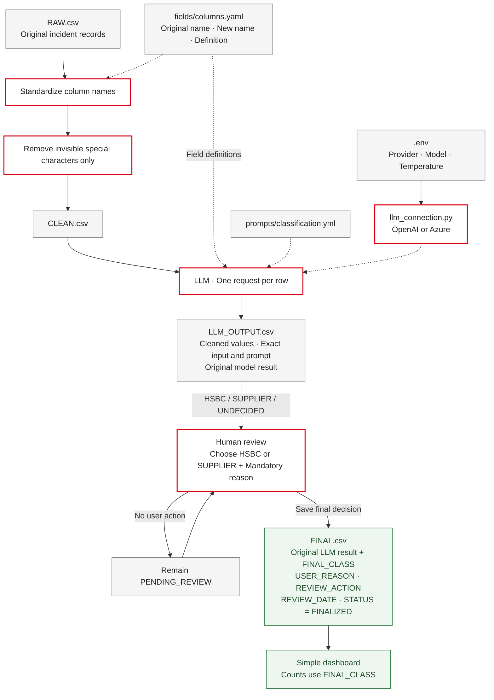

# Demo architecture

The pipeline is manual: read, rename, clean, prepare, classify, save. Names and definitions have one source of truth in columns.yaml. CLEAN.csv is generated, not manually maintained.

Cleaning removes invisible Unicode control/format characters except tabs and line breaks. It preserves punctuation, symbols, emails, HTML, and ordinary whitespace. INCIDENT_ID is unchanged and excluded from model input.

Each successful model response remains pending until the user submits HSBC or SUPPLIER with a reason. Confirmation, correction, and resolution of UNDECIDED all write FINAL.csv. Human-review routing files are no longer used.

The saved llm_input and llm_prompt cells preserve the request's exact fields, definitions, values, and instructions. Review and dashboard make no model calls. The dashboard reads FINAL.csv independently.

Run one local worker and finish a batch before review. A process lock serializes writes, atomic replacement preserves existing files on save errors, unique IDs prevent duplicates, and versions reject stale decisions.
