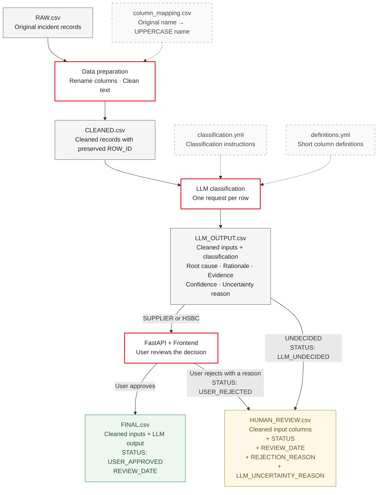

# Demo architecture

The manual pipeline saves cleaned data before calling the model. LLM_OUTPUT.csv contains the same cleaned values and structured results. FastAPI reads this self-contained output without making model calls.

Human review receives cleaned columns plus STATUS, REVIEW_DATE, REJECTION_REASON, and LLM_UNCERTAINTY_REASON. Final approval keeps the model results too. ROW_ID links all files.

Uncertain rows are routed during classification, at app startup, and on explicit reload. Existing rows are skipped so dates remain unchanged. Review never edits raw data, CLEANED.csv, or LLM_OUTPUT.csv.

One local worker and a lock serialize writes. CSV replacement is atomic and duplicate/stale decisions are rejected. This is a small demo; complete a batch before reviewing it.
